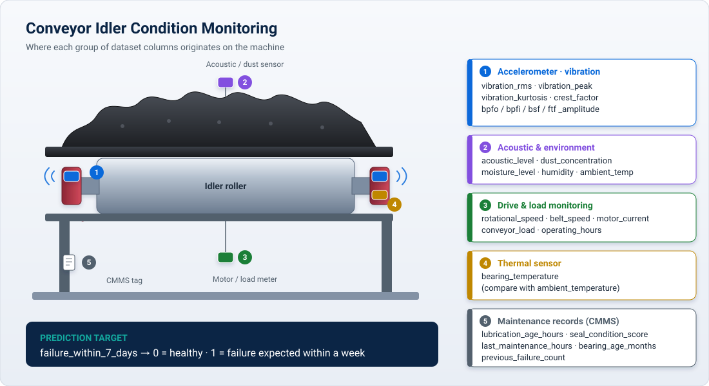
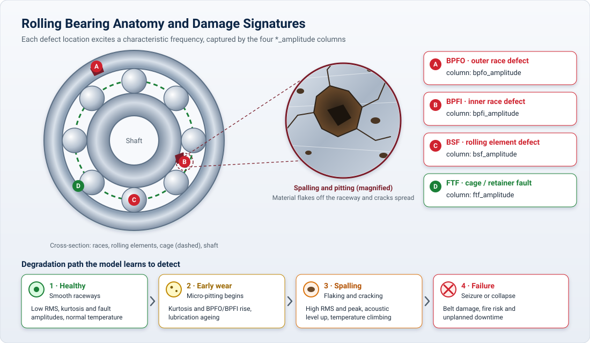
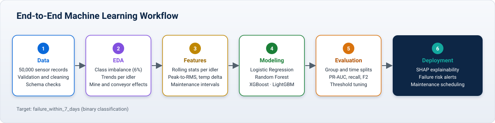
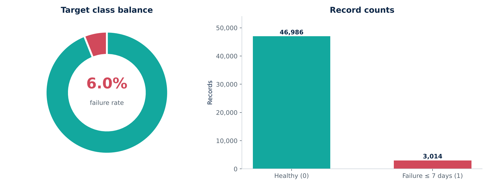
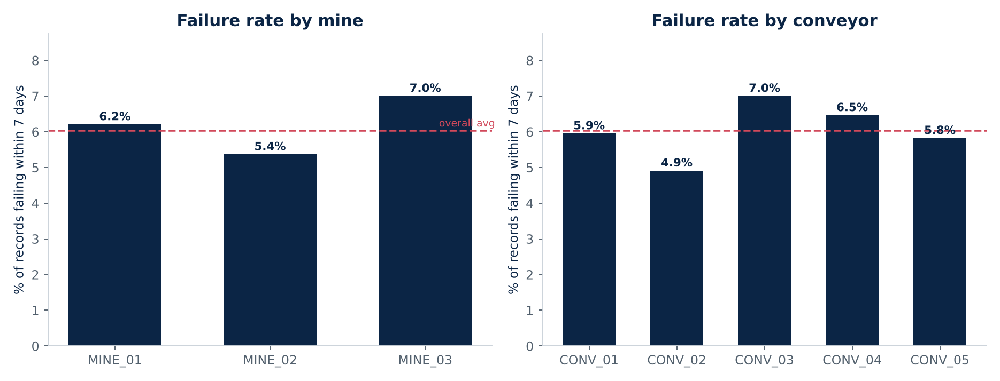
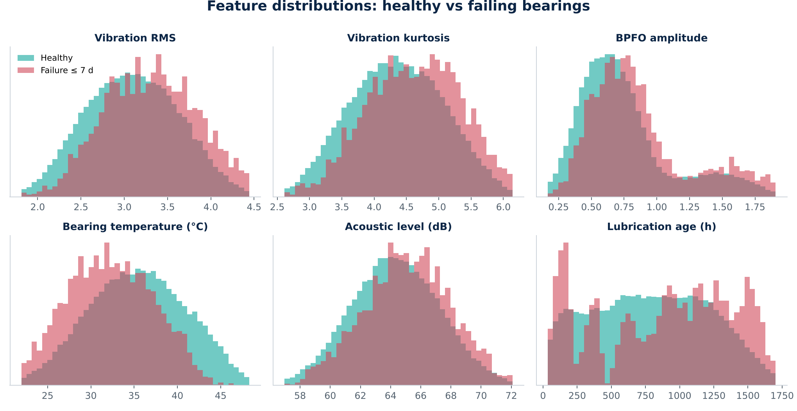
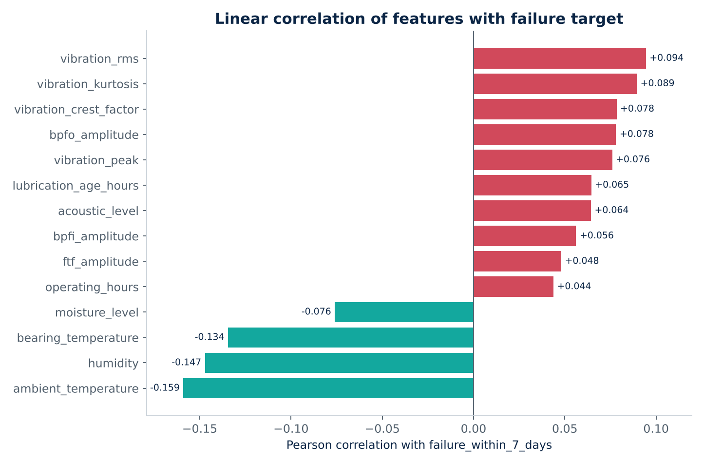

<p align="center">
  
</p>

# Coal Mine Conveyor Bearing Predictive Maintenance

> Machine learning pipeline to predict conveyor idler bearing failures **7 days ahead** in coal mines, using vibration, thermal, acoustic, environmental and operational sensor data.


---

## Table of Contents

1. [Overview](#overview)
2. [Business Problem](#business-problem)
3. [Visual Overview](#visual-overview)
4. [Dataset](#dataset)
5. [Exploratory Data Analysis](#exploratory-data-analysis)
6. [Project Structure](#project-structure)
7. [Installation](#installation)
8. [Usage](#usage)
9. [Methodology](#methodology)
10. [Evaluation Strategy](#evaluation-strategy)
11. [Results](#results)
12. [Roadmap](#roadmap)
13. [Contributing](#contributing)
14. [License](#license)
15. [Contact](#contact)

---

## Overview

Conveyor belt systems are the backbone of coal transport, and a single failed idler bearing can cause belt damage, fires and hours of unplanned downtime. This project builds a data-driven predictive maintenance solution that flags bearings likely to fail within the next 7 days, so maintenance crews can act before a breakdown occurs.

### Key objectives

- Predict `failure_within_7_days` for each idler bearing (binary classification).
- Identify the sensor signals and operating conditions that drive failure risk.
- Provide an interpretable, deployment-ready model for maintenance planning.

---

## Business Problem

| Reactive maintenance | Predictive maintenance (this project) |
|---|---|
| Fix after failure | Intervene before failure |
| Unplanned downtime | Scheduled, low-impact stops |
| Higher safety and fire risk | Reduced hazard exposure |
| Costly emergency repairs | Optimised spare parts and crew planning |

---

## Visual Overview

### How the sensors map to the dataset

Each row in the dataset is one sensor snapshot for one idler bearing. The diagram shows where each group of columns originates on the machine.

<p align="center">
  
</p>

### Bearing anatomy and damage signatures

The four `*_amplitude` columns correspond to the characteristic fault frequencies of a rolling bearing. Rising amplitudes, together with higher kurtosis and crest factor, are early warnings of damage such as spalling and pitting.

<p align="center">
  
</p>

### End-to-end workflow

<p align="center">
  
</p>

<!--
### Reference photos (optional)

Add licensed or self-taken photos to docs/images/ and uncomment this block.

| Coal conveyor idlers | Bearing spalling damage | Vibration sensor on a bearing |
|---|---|---|
|  |  |  |
-->

---

## Dataset

**File:** `preventative_maintainance_dataset.csv`

| Property | Value |
|---|---|
| Records | 50,000 |
| Columns | 30 (29 predictors/identifiers + 1 target) |
| Time span | 2026-01-01 to 2026-01-25 |
| Mines | 3 (`MINE_01`, `MINE_02`, `MINE_03`) |
| Conveyors | 5 |
| Idlers (bearings) | 500 (100 records each) |
| Missing values | None |
| Duplicate rows | None |
| Target | `failure_within_7_days` (0 = healthy, 1 = failure within 7 days) |

### Class balance

The target is **imbalanced**: about **6.0%** of records (3,014 of 50,000) are positive. Accuracy alone is therefore a misleading metric; see [Evaluation Strategy](#evaluation-strategy).

### Feature dictionary

| Group | Features |
|---|---|
| **Identifiers** | `record_id`, `timestamp`, `mine_id`, `conveyor_id`, `idler_id` |
| **Vibration** | `vibration_rms`, `vibration_peak`, `vibration_kurtosis`, `vibration_crest_factor` |
| **Bearing fault frequencies** | `bpfo_amplitude` (outer race), `bpfi_amplitude` (inner race), `bsf_amplitude` (ball spin), `ftf_amplitude` (cage) |
| **Thermal and acoustic** | `bearing_temperature`, `acoustic_level` |
| **Mechanical / operating** | `rotational_speed`, `conveyor_load`, `belt_speed`, `motor_current`, `operating_hours` |
| **Environment** | `ambient_temperature`, `humidity`, `dust_concentration`, `moisture_level` |
| **Maintenance and condition** | `lubrication_age_hours`, `last_maintenance_hours`, `previous_failure_count`, `seal_condition_score`, `bearing_age_months` |
| **Target** | `failure_within_7_days` |

> **Note:** Individual linear correlations with the target are weak (all below 0.16 in absolute value). This suggests that non-linear models and engineered features (rolling statistics, ratios, maintenance intervals) will add value. See the charts below.

---

## Exploratory Data Analysis

### Class imbalance

Only about 6% of records belong to the failure class, so accuracy is a misleading metric and imbalance handling is required.

<p align="center">
  
</p>

### Failure rate by mine and conveyor

Failure rates differ only modestly between mines and conveyors, so location alone is not a strong predictor.

<p align="center">
  
</p>

### Healthy vs failing bearings

Failing bearings tend to show higher vibration RMS, kurtosis and BPFO amplitude, and a more worn lubrication profile. The distributions overlap heavily, which is why a multi-feature model is needed.

<p align="center">
  
</p>

### Correlation with the target

<p align="center">
  
</p>

> **To investigate:** `ambient_temperature`, `humidity` and `bearing_temperature` show the strongest (negative) correlations in this dataset. Check for confounding with mine, season or operating conditions before drawing conclusions.

---

## Project Structure

```
coal-mine-bearing-predictive-maintenance/
├── data/
│   ├── raw/                  # preventative_maintainance_dataset.csv (not tracked by git if large)
│   ├── interim/              # Cleaned / intermediate data
│   └── processed/            # Model-ready datasets
├── notebooks/
│   ├── 01_eda.ipynb
│   ├── 02_feature_engineering.ipynb
│   ├── 03_modeling.ipynb
│   └── 04_explainability.ipynb
├── src/
│   ├── data/                 # Loading and validation
│   ├── features/             # Feature engineering
│   ├── models/               # Training, tuning, inference
│   └── visualization/        # Plotting utilities
├── models/                   # Saved model artefacts
├── docs/
│   └── images/               # Banner, diagrams and EDA charts used in this README
├── reports/
│   └── figures/
├── tests/
├── requirements.txt
├── .gitignore
├── LICENSE
└── README.md
```

---

## Installation

```bash
# 1. Clone the repository
git clone https://github.com/chandanc5525/coal-mine-bearing-predictive-maintenance.git
cd coal-mine-bearing-predictive-maintenance

# 2. Create and activate a virtual environment
python -m venv .venv
source .venv/bin/activate        # Windows: .venv\Scripts\activate

# 3. Install dependencies
pip install -r requirements.txt
```

**Suggested `requirements.txt`**

```
pandas
numpy
scikit-learn
xgboost
lightgbm
imbalanced-learn
shap
matplotlib
seaborn
jupyter
joblib
```

---

## Usage

```bash
# Place the dataset
cp /path/to/preventative_maintainance_dataset.csv data/raw/

# Run exploratory analysis
jupyter notebook notebooks/01_eda.ipynb

# Train a model
python -m src.models.train --config configs/baseline.yaml

# Generate predictions
python -m src.models.predict --input data/raw/new_readings.csv --output reports/predictions.csv
```

---

## Methodology

1. **Data validation:** schema checks, range checks, timestamp parsing.
2. **Exploratory data analysis:** class balance, distributions by mine and conveyor, degradation trends, correlation analysis.
3. **Feature engineering**
   - Time features (hour, day of week).
   - Rolling statistics per `idler_id` (mean, std, slope of vibration and temperature).
   - Ratios such as peak-to-RMS and temperature-to-ambient delta.
   - Fault-frequency aggregates across BPFO, BPFI, BSF and FTF.
   - Maintenance-interval features (time since lubrication and maintenance).
4. **Modeling:** baseline Logistic Regression, Random Forest, XGBoost, LightGBM.
5. **Imbalance handling:** class weights, SMOTE or focal-style weighting, threshold tuning.
6. **Hyperparameter tuning:** Optuna or randomized search with grouped cross-validation.
7. **Explainability:** SHAP values and feature importance for maintenance-team transparency.

---

## Evaluation Strategy

To avoid **data leakage** and over-optimistic results:

- **Group-aware splits:** hold out entire `idler_id`s (e.g. `GroupKFold`) so the model is tested on bearings it has never seen.
- **Time-aware splits:** validate on later timestamps than the training data.
- **Metrics suited to imbalance:** PR-AUC, Recall, Precision, F1, F2 (recall-weighted), ROC-AUC, and a confusion matrix at the operating threshold.
- **Cost-aware thresholding:** choose a decision threshold that reflects the cost of a missed failure versus a false alarm.

---

## Results

_To be updated after experiments._

| Model | ROC-AUC | PR-AUC | Precision | Recall | F1 |
|---|---|---|---|---|---|
| Logistic Regression (baseline) | – | – | – | – | – |
| Random Forest | – | – | – | – | – |
| XGBoost | – | – | – | – | – |
| LightGBM | – | – | – | – | – |

---

## Roadmap

- [ ] Complete EDA and data-quality report
- [ ] Build feature engineering pipeline
- [ ] Train and benchmark baseline models
- [ ] Add grouped and time-based cross-validation
- [ ] SHAP-based explainability report
- [ ] Remaining-useful-life (RUL) regression extension
- [ ] REST API for inference (FastAPI)
- [ ] Interactive dashboard (Streamlit)
- [ ] Docker container and CI pipeline

---

## Contributing

Contributions are welcome.

1. Fork the repository
2. Create a feature branch: `git checkout -b feature/your-feature`
3. Commit your changes: `git commit -m "Add your feature"`
4. Push to the branch: `git push origin feature/your-feature`
5. Open a Pull Request

---

## License

Distributed under the MIT License. See `LICENSE` for details.

---

## Contact

**Chandan Chaudhari**

- Email: [chaudhari.chandan22@gmail.com](mailto:chaudhari.chandan22@gmail.com)
- GitHub: [@chandanc5525](https://github.com/chandanc5525)

---

<p align="center">⭐ If you find this project useful, please consider giving it a star.</p>